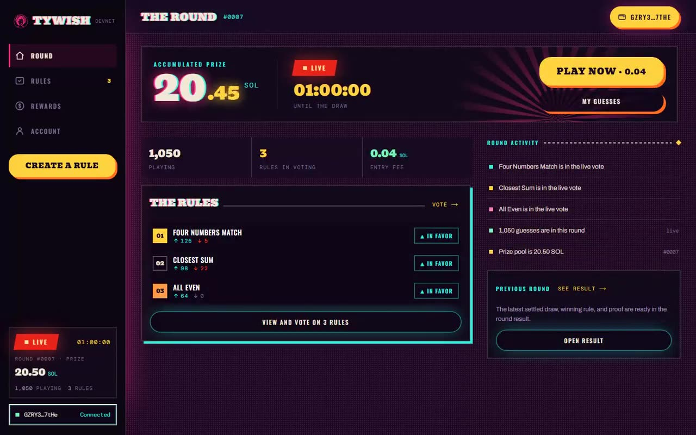

# Tywish

Tywish is a mobile-first game on Solana where players pick six numbers and vote on an alternative way to win each round. Players describe rules in plain language to the AI Dealer, which turns an accepted proposal into a rule the game can evaluate deterministically.

## Watch a round

[](https://raw.githubusercontent.com/IagoPrandi/ai-dealer/main/apps/web/public/videos/tywish-round.mp4)

[Watch the 48-second demo (MP4)](https://raw.githubusercontent.com/IagoPrandi/ai-dealer/main/apps/web/public/videos/tywish-round.mp4). The recording uses the desktop interface and sample data to show a player writing a rule, picking numbers, voting, and seeing the result.

## How a rule becomes part of the game

1. **Describe a condition.** For example, “Win if at least four of my six picks appear among the drawn numbers.” The Dealer screens the input and presents its interpretation for confirmation.
2. **Compile and validate.** The pipeline compiles the confirmed interpretation into a constrained rule representation, then checks its structure and tests its behavior on example guesses and draws.
3. **Select and lock a rule.** Eligible proposals take part in the round's election. The active alternative rule is locked before the draw.
4. **Evaluate the result.** The deterministic runtime evaluates the locked rule against the guess and the draw. The AI Dealer handles interpretation and compilation. See the [game rules](docs/product-rule-summary.md) and [rule representation](docs/rule-algebra-core-design.md).

## Try it locally

Use Git, Node.js 24 or later, and pnpm 10.27.0. Run the UI gallery to explore sample screens without a backend, model credentials, or a wallet.

```bash
git clone https://github.com/IagoPrandi/ai-dealer.git
cd ai-dealer
pnpm install --frozen-lockfile
pnpm --filter @tyche/web dev:mock
```

Open [the UI gallery](http://localhost:3000/dev/gallery). The [home page](http://localhost:3000) also plays the product recording.

### Run the development stack

Install Docker with Compose and stop the gallery before starting the standard web server on the same port. From the repository root, copy `.env.example` to `.env` (`cp .env.example .env`, or `Copy-Item .env.example .env` in PowerShell).

For local exploration, set `TYCHE_TURN_AUTOMATION_ENABLED=false` in `.env`. Compose expects existing local volumes for PostgreSQL and Redis.

```bash
docker volume create tyche-postgres-data
docker volume create tyche-redis-data
docker compose up -d postgres redis
```

Start each service in a separate terminal.

| Service          | Command                           | Local URL                                    |
| ---------------- | --------------------------------- | -------------------------------------------- |
| Web              | `pnpm --filter @tyche/web dev`    | [localhost:3000](http://localhost:3000)      |
| API              | `pnpm --filter @tyche/api dev`    | [Health check](http://localhost:3002/health) |
| Worker           | `pnpm --filter @tyche/worker dev` | [Health check](http://localhost:3003/health) |
| Admin (optional) | `pnpm --filter @tyche/admin dev`  | [localhost:3001](http://localhost:3001)      |

To exercise live rule compilation, configure the chat model and credentials, two distinct compiler models (`LLM_MODEL_COMPILE` and `LLM_MODEL_COMPILE_B`), and the semantic review endpoint (`JEV_ENDPOINT`). The [environment template](.env.example) documents each role and its provider requirements. The [local runbook](docs/local-development-runbook.md) covers local configuration, and the [devnet runbook](docs/devnet-turn-operations-runbook.md) covers configured test wallets, turn authority, and on-chain test rounds.

## Repository map

| Path                                                                                                                                                                 | Responsibility                                                                                          |
| -------------------------------------------------------------------------------------------------------------------------------------------------------------------- | ------------------------------------------------------------------------------------------------------- |
| [`apps/web`](apps/web)                                                                                                                                               | Next.js progressive web app for play, proposals, voting, and round history                              |
| [`apps/api`](apps/api) and [`apps/worker`](apps/worker)                                                                                                              | Rule conversations, proposal validation, and background round operations backed by PostgreSQL and Redis |
| [`packages/rule-compiler`](packages/rule-compiler), [`packages/rule-runtime`](packages/rule-runtime), and [`packages/rule-test-harness`](packages/rule-test-harness) | Compile, evaluate, and test rule artifacts                                                              |
| [`contracts/solana`](contracts/solana)                                                                                                                               | Rust/Anchor programs and on-chain instruction tests                                                     |

Tywish is the product name. The workspace uses `@tyche/*` for packages and `TYCHE_*` for environment variables.

## Development checks

```bash
pnpm lint
pnpm typecheck
pnpm test
pnpm build
```

For deployment and infrastructure, see the [AWS guide](infra/aws/README.md) and [CI workflows](.github/workflows).
