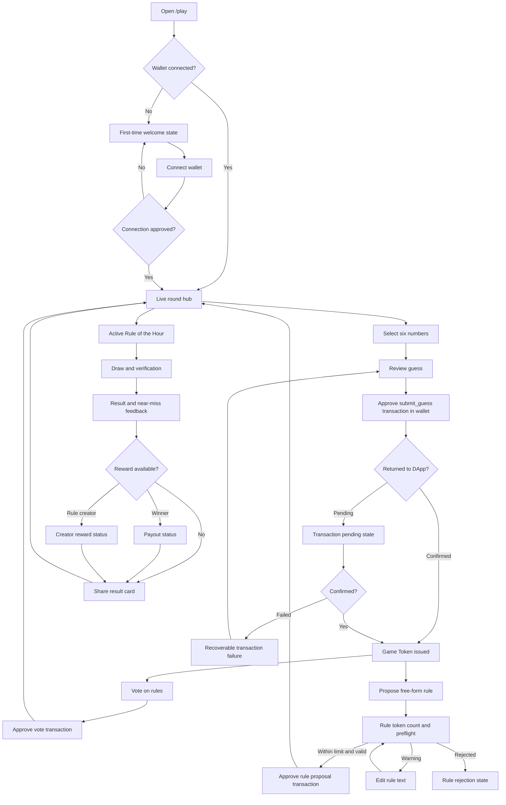
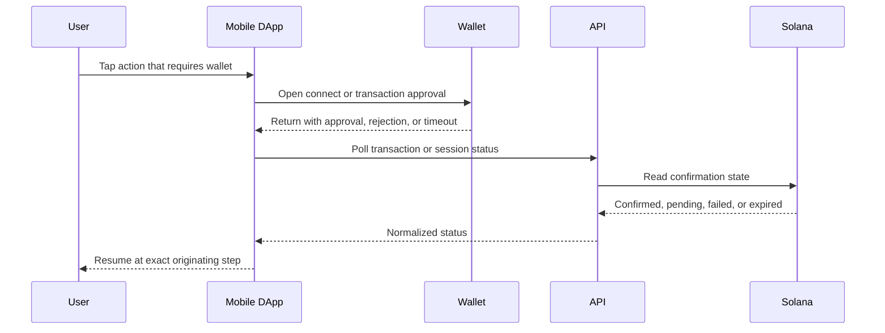

# Mobile User Flow Diagram

This is the M0.5 mobile-first flow baseline for `/play`. The route is the primary public DApp entry point for mobile browsers, in-wallet browsers, and mobile wallet deep-link returns.

## Primary Route

- `/play` is the default mobile game route.
- Desktop may reuse the same route with wider layout affordances, but no critical action may require desktop navigation.
- Bottom navigation and sticky primary calls to action must keep the current turn, number entry, rule voting, rule proposal, and result history reachable with one-handed use.

## Core Game Loop

## First-Time User Flow

1. User lands on `/play`.
2. The live round hub shows prize, countdown, current action, and compact explanation of the loop.
3. User connects wallet from a single primary action.
4. After wallet return, the hub confirms connected status and exposes number selection.
5. User selects six unique numbers, reviews fees, and approves `submit_guess`.
6. The DApp waits for confirmation and then shows the current-turn Game Token status.
7. Voting and rule proposal become available after Game Token issuance.

## Returning User Flow

1. User opens `/play` with an already known wallet session.
2. The hub restores current turn state, submitted guess status, Game Token status, votes, proposals, and pending rewards.
3. If the user has not submitted a guess for the current turn, number selection is the primary action.
4. If the user already submitted a guess, voting, proposing, result tracking, and sharing become primary actions.
5. If the previous turn has unclaimed payout or creator reward status, a compact reward banner appears without blocking the current turn.

## Wallet Connection And Transaction Return Flow

Mobile wallet interruption rules:

- The DApp must preserve the originating action and form state before leaving for wallet approval.
- On return, the user must land on the same step with a visible transaction status.
- Pending transactions must not silently reset the flow.
- Failed or rejected transactions must return to an editable review state.

## Action Flows

### Number Selection

1. Enter from `/play` primary CTA.
2. Select exactly six unique numbers from 1 to 100.
3. Show selected numbers in a sticky tray.
4. Enable review only when exactly six numbers are selected.
5. Submit through wallet transaction approval.
6. On confirmation, show Game Token issued and unlock gated actions.

### Free-Form Rule Proposal

1. Enter from bottom navigation or post-guess prompt.
2. User writes natural language rule text.
3. Client requests token count and preflight.
4. Warning state appears near the 80-token limit before hard rejection.
5. Rejection states must show a clear reason and preserve editable text.
6. Passing preflight returns a short-lived preflight token.
7. User approves proposal transaction.
8. Proposed rule appears with compilation status.

### Voting

1. Enter from rule list, live hub, or active rule panel.
2. User reviews eligible rules with vote count, status, and audit link.
3. Voting requires current-turn Game Token.
4. User approves vote transaction.
5. The UI returns to the rule list with pending or confirmed vote status.

### Result And Sharing

1. Draw state appears when guesses close and draw is pending.
2. Verification state appears while original and alternative conditions are evaluated.
3. Result state shows drawn numbers, original result, alternative rule result, near-miss feedback, payout status, and creator reward status.
4. Share card flow creates a non-sensitive summary with turn id, draw numbers, near-miss label, and active rule title.
